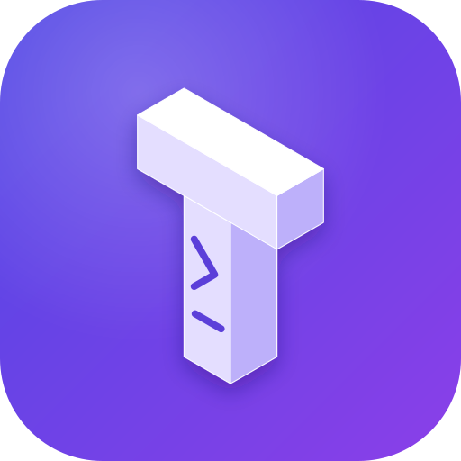
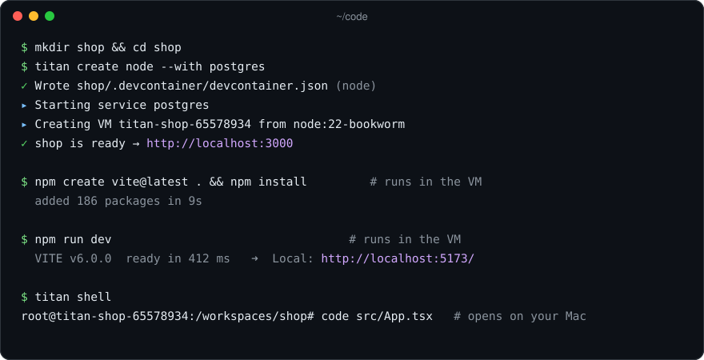

<p align="center">
  
</p>

<h1 align="center">Titan</h1>

<p align="center">
  <b>Reproducible per-project Linux dev environments on your Mac, in lightweight VMs.</b>
</p>

<p align="center">
  <a href="https://github.com/manoj1604/titan/actions/workflows/ci.yml"></a>
  <a href="https://github.com/manoj1604/titan/releases/latest"></a>
  <a href="LICENSE"></a>
  
</p>

<p align="center">
  <a href="#install">Install</a> ·
  <a href="docs/guide/03-first-project.md">Quick start</a> ·
  <a href="docs/README.md">Documentation</a> ·
  <a href="docs/faq.md">FAQ</a> ·
  <a href="CHANGELOG.md">Changelog</a>
</p>

<p align="center">
  
</p>

Every project gets its own Linux VM, defined by a standard `devcontainer.json` and pinned by
`titan.lock`. Your editor and files stay on the Mac, and commands run in the VM. "Works on my
machine" then means it works on every machine.

A teammate just clones and works:

```console
$ git clone https://github.com/acme/shop && cd shop
$ npm run dev
▸ Setting up shop (first run; later runs start instantly)…
✓ shop is ready
  VITE ready → http://localhost:5173
```

Titan is built on [Apple's `container`](https://github.com/apple/container) runtime. Each VM
is a lightweight virtual machine with its own Linux kernel, not a shared Docker daemon. Titan
needs no Docker, no account and no background app, and collects no telemetry.

> Titan is an independent open-source project. It is not affiliated with or endorsed by Apple.

## Why

- **Same environment everywhere.** The runtime, OS packages and services come from a
  committed config, with every image pinned by digest. A teammate's first `npm test` gets
  exactly your setup.
- **Nothing to install per project.** Node, Python, Postgres and the rest run in the VM.
  Your Mac doesn't need them, even to *create* a project.
- **No new workflow.** With the shell hook, `npm`, `python` and `go` in a project run in its
  VM automatically. You keep your editor, terminal and habits.
- **Isolated by default.** One VM per project, so one project's dependencies never break
  another's.

## Requirements

- A Mac with Apple silicon (M1 or later), running **macOS 26** or later
- [Apple `container`](https://github.com/apple/container) 1.7+ (Homebrew installs it with Titan)

## Install

```bash
# Homebrew (tap)
brew install manoj1604/titan/titan

# or the release tarball
curl -fsSL https://github.com/manoj1604/titan/releases/latest/download/titan-macos-arm64.tar.gz | tar -xz
cd titan-*-macos-arm64 && sudo cp -R bin share /usr/local/
```

There's no setup step: the first `titan create` starts Apple's container service and sets
up your shell (and VS Code and Claude Code, if installed). Building from source is covered
in [CONTRIBUTING.md](CONTRIBUTING.md).

## Quick start

**Start a new project:**

```console
$ mkdir shop && cd shop
$ titan create node --with postgres
✓ Wrote shop/.devcontainer/devcontainer.json (node)
✓ shop is ready → http://localhost:3000
$ npm create vite@latest . && npm install && npm run dev     # all in the VM
```

Languages: `node`, `python`, `go`, `rust`, `ruby`, `java` (pick a version with `@`, e.g.
`python@3.13`).

**Work on an existing project:**

```bash
cd my-repo
titan create      # detects Node/Python/Go/Rust/Ruby/Java and their versions
npm test          # runs in the VM; or: titan run -- npm test
```

Commit `.devcontainer/devcontainer.json` and `titan.lock` so teammates get the same VM.

Once a repo contains `devcontainer.json` or `titan.lock`, teammates just clone it, `cd`
into it and run their usual commands. There's no `titan up` step for them.

## What you get

| | |
|---|---|
| **Standard config** | Dev Container `devcontainer.json` (image, build, ports, env, lifecycle commands, node/python features), so the same file works in VS Code Dev Containers and Codespaces |
| **Pinned images** | `titan.lock` records exact digests for the app image, services and toolchains |
| **Localhost just works** | Dev servers bound to `127.0.0.1` (Vite, Django, Flask, Rails) are reachable from the Mac; busy ports are remapped and shown |
| **Services** | `titan add postgres redis`: each in its own VM, reachable by name, `DATABASE_URL`/`REDIS_URL` set, data kept across rebuilds |
| **Shared toolchain store** | Node and Python installed once per Mac and mounted read-only into VMs, about half the disk of one image per runtime at the same speed |
| **Shared package cache** | npm, pip and Go modules are downloaded once per Mac, not once per project |
| **Sharing** | `titan share` gives a public HTTPS link to your app (Cloudflare quick tunnel) |
| **AI-ready** | Coding agents (Claude Code, Codex, Cursor) on your Mac run project commands in the VM from any shell; `AGENTS.md` notes tell them how the project runs |
| **Visibility** | `titan status` shows the project's VM with live CPU and memory; `titan status --all` shows every VM |
| **Housekeeping** | `titan gc` removes images and toolchains no project needs; VM memory defaults to half your RAM, capped at 8 GB |

## Commands

| Command | What it does |
|---|---|
| `titan create [node\|python\|go\|rust\|ruby\|java]` | Set up this folder: config, VM (and, the first time, your Mac) |
| `titan up [--rebuild]` / `titan down [--rm]` | Start (or recreate) / stop (or delete) the project's VM |
| `titan run -- <cmd>` / `titan shell` | Run a command or open a shell in the VM |
| `titan add <service>` | Add Postgres, Redis or any image as a service |
| `titan share [port]` | Public HTTPS link to the app |
| `titan logs [service]` | A service's log |
| `titan status [--all]` | This project's VM (or every VM), with live CPU and memory |
| `titan doctor` / `titan gc [--cache]` | Check for problems / free disk space |

Full reference: [docs/cli.md](docs/cli.md) (also `titan help <command>` and `man titan`).

## Documentation

**[The Titan guide](docs/README.md)** covers everything step by step, in plain language:

1. [Install Titan](docs/guide/01-install.md)
2. [The big idea](docs/guide/02-key-ideas.md): projects, VMs and the few files Titan uses
3. [Your first project](docs/guide/03-first-project.md)
4. [Use Titan with an existing project](docs/guide/04-existing-projects.md)
5. [Everyday commands](docs/guide/05-everyday-use.md)
6. [Databases and other services](docs/guide/06-databases.md)
7. [Ports, URLs and sharing](docs/guide/07-ports-and-sharing.md)
8. [Working in a team](docs/guide/08-teams.md)
9. [Editors (VS Code and others)](docs/guide/09-editors.md)
10. [Disk space, memory and cleanup](docs/guide/10-disk-and-cleanup.md)
11. [Coding agents (Claude Code, Codex, Cursor)](docs/guide/11-coding-agents.md)

Reference: [FAQ](docs/faq.md) · [Troubleshooting](docs/troubleshooting.md) ·
[Configuration](docs/configuration.md) · [Commands](docs/cli.md) · [How it works](docs/how-it-works.md)

## Status

Titan is **0.x**: usable day to day, with commands and config that may still change before
1.0. Known limitations:

- Apple silicon and macOS 26+ only (an Apple `container` requirement).
- Not supported yet: Docker Compose-based devcontainers and Dev Container features other
  than `node` and `python`.
- File locks aren't shared between VMs, so only lock-free package caches are shared
  (npm, pip, Go modules).

## Contributing

Issues and pull requests are welcome. See [CONTRIBUTING.md](CONTRIBUTING.md) for how to build,
test and propose changes, and [SECURITY.md](SECURITY.md) to report a vulnerability privately.
This project follows the [Code of Conduct](CODE_OF_CONDUCT.md).

## License

[Apache License 2.0](LICENSE). Copyright The Titan Authors.
