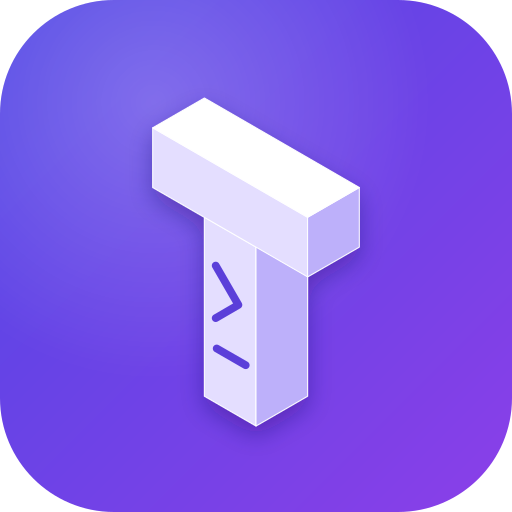

<p align="center"></p>

# Titan documentation

Titan runs each of your projects inside its own small Linux computer (a **VM**) on your
Mac. You keep using your normal editor and terminal. Titan makes sure every project gets
exactly the same tools on every machine.

**New here?** Read the guide in order. Each page takes about 5 minutes.

## The guide

| # | Page | You'll learn to… |
|---|---|---|
| 1 | [Install Titan](guide/01-install.md) | install Titan and get your Mac ready |
| 2 | [The big idea](guide/02-key-ideas.md) | understand projects, VMs and the few files Titan uses |
| 3 | [Your first project](guide/03-first-project.md) | create a web app and see it in your browser |
| 4 | [Use Titan with an existing project](guide/04-existing-projects.md) | run a project you already have |
| 5 | [Everyday commands](guide/05-everyday-use.md) | run commands, open a shell, start and stop |
| 6 | [Databases and other services](guide/06-databases.md) | add Postgres or Redis, connect to them, keep your data |
| 7 | [Ports, URLs and sharing](guide/07-ports-and-sharing.md) | open your app in a browser and share a public link |
| 8 | [Working in a team](guide/08-teams.md) | give teammates the exact same setup |
| 9 | [Editors (VS Code and others)](guide/09-editors.md) | use your editor and its terminal with Titan |
| 10 | [Disk space, memory and cleanup](guide/10-disk-and-cleanup.md) | see what Titan uses and free space |
| 11 | [Coding agents](guide/11-coding-agents.md) | Claude Code, Codex and Cursor in your VMs, or sandboxed inside one |

## Look things up

- [FAQ](faq.md): short answers to common questions
- [Troubleshooting](troubleshooting.md): something isn't working
- [Configuration reference](configuration.md): every setting in `devcontainer.json` and `titan.lock`
- [Command reference](cli.md): every command and option
- [How it works](how-it-works.md): what happens under the hood, and why

## The 30-second version

```bash
brew install manoj1604/titan/titan     # install
titan setup                            # get your Mac ready (once)
titan new myapp --template vite        # create a project
npm run dev                            # it runs in the VM → http://localhost:5173
```
